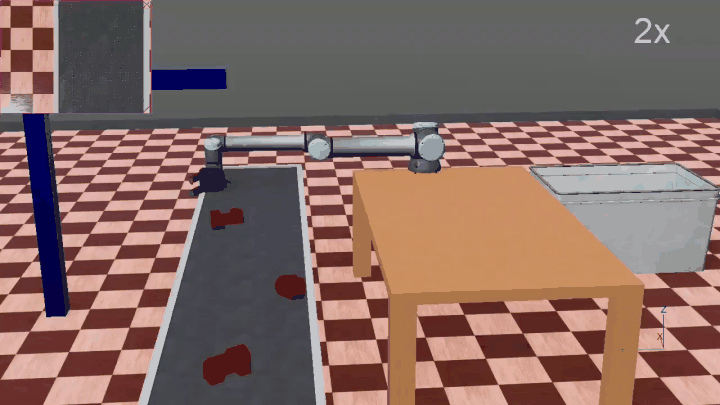
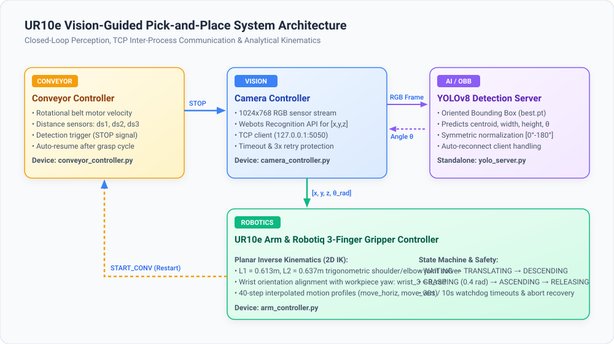
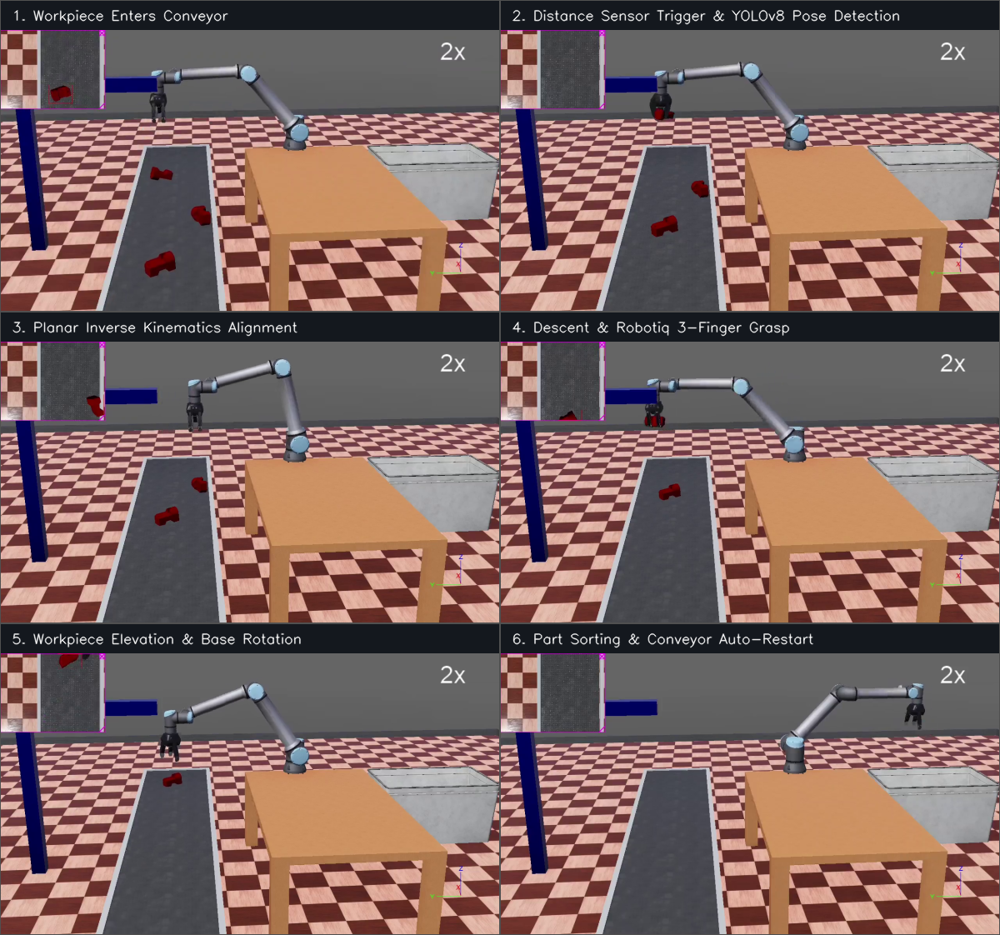
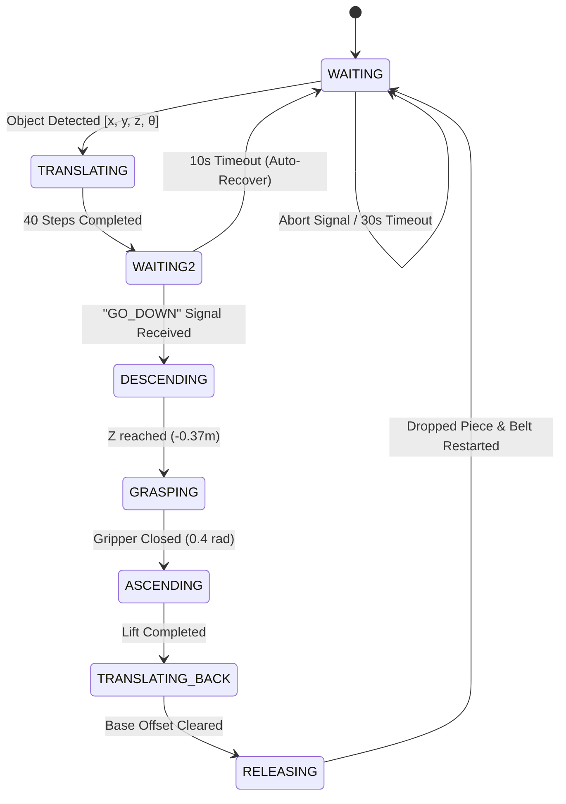

# 🦾 Autonomous Vision-Guided Pick-and-Place with UR10e & YOLOv8 OBB

<div align="center">

[](https://www.python.org/)
[](https://cyberbotics.com/)
[](https://ultralytics.com)
[](https://www.universal-robots.com/)
[](https://robotiq.com/)
[](LICENSE)

**An industrial-grade robotic pick-and-place perception & manipulation pipeline in Webots.**  
*Combines real-time YOLOv8 Oriented Bounding Box (OBB) inference, custom analytical Inverse Kinematics, inter-process TCP streaming, and a fault-tolerant finite state machine.*

<br/>

<!-- Hero Animation -->


<p align="center">
  <b>⚡ Accelerated Simulation Demo (2.5x speed)</b><br/>
  <i>High-definition video available: <a href="linkedin-video-accelerated.mp4"><code>linkedin-video-accelerated.mp4</code></a> or <a href="assets/simulation_accelerated_h264.mp4"><code>assets/simulation_accelerated_h264.mp4</code></a></i>
</p>

</div>

---

## 👨‍💻 Author & Engineering Profile

**Jasser Chaabane**  
*Robotics & Mechatronics Engineering Student | National Engineering School of Sousse (ENISO)*  

- 💼 **LinkedIn**: [linkedin.com/in/jasser-chaabane](https://www.linkedin.com/in/jasser-chaabane)
- 🐙 **GitHub**: [github.com/Jasser-ch](https://github.com/Jasser-ch)
- 📧 **Email**: [jasser.chaabane@eniso.u-sousse.tn](mailto:jasser.chaabane@eniso.u-sousse.tn)
- 📄 **Curriculum Vitae**: [View Resume / CV (PDF)](cv.pdf)

---

## 📌 Executive Summary & Key Highlights

This project implements a complete, closed-loop industrial sorting workstation simulated in Webots. A 6-DOF Universal Robots UR10e equipped with a Robotiq 3-finger adaptive gripper detects, tracks, dynamically aligns, and grasps randomly oriented prismatic parts traveling on a conveyor belt.

### 🌟 Technical Highlights
- **Real-Time Oriented Bounding Box (OBB) Detection**: Utilizes a trained YOLOv8 model (`best.pt`) to output arbitrary workpiece orientation angles $\theta \in [0^\circ, 180^\circ]$ for symmetric rectangular grasping.
- **Inter-Process TCP Architecture**: Decoupled deep learning inference server communicating with the Webots simulation via high-throughput local TCP sockets (`127.0.0.1:5050`) using custom binary packet serialization.
- **Analytical Planar Inverse Kinematics**: Trigonometrically solved 2-link planar IK for shoulder and elbow joints ($L_1 = 0.613\,\text{m}, L_2 = 0.637\,\text{m}$) combined with automated 3D wrist pitch/yaw alignment.
- **Smooth Trajectory Interpolation**: 40-step discretized trajectory planning generating jerk-free reach, descend, lift, and sort trajectories.
- **Industrial Reliability & Watchdog Safeguards**:
  - 3-attempt automated reconnection and detection retries.
  - Abort signaling to prevent controller deadlock if visual recognition fails.
  - 30-second `WAITING` and 10-second `WAITING2` state watchdog timeouts with automatic self-recovery.

---

## 🏗️ System Architecture

The workstation is partitioned into modular controllers coordinated via Webots Emitters/Receivers and a TCP socket server:

<div align="center">
  
</div>

### Workstation Communication Flow
```
[ Conveyor Belt (ds1) ]
         │ (Workpiece detected)
         ▼ (String: "STOP")
[ Camera Controller ] ──(Raw RGB frame over TCP)──► [ YOLOv8 OBB Server ]
         ▲                                                    │
         │◄────────(Angle θ degrees returned)─────────────────┘
         │
         │ (Position [x, y, z] + Angle θ_rad)
         ▼
[ UR10e Arm Controller ] ──(Calculates 2D IK + Trajectories)──► [ Robotiq Gripper ]
         │
         │ (Pick, lift, rotate, drop-off complete)
         ▼ (String: "START_CONV")
[ Conveyor Belt Controller ] (Resumes belt motion)
```

---

## 🔄 End-to-End Pick-and-Place Sequence

The multi-stage automated cycle handles workpiece arrival, visual pose estimation, grasping, sorting, and conveyor reactivation:

<div align="center">
  
</div>

---

## 📐 Mathematical Formulation & Inverse Kinematics

The UR10e arm operates within a defined planar operational workspace for picking from the conveyor. The geometric planar 2-link model computes joint positions for the **shoulder lift joint** ($\theta$) and **elbow joint** ($\phi$):

### Kinematic Parameters
- Upper arm length: $L_1 = 0.613\,\text{m}$
- Forearm length: $L_2 = 0.637\,\text{m}$
- Base reference coordinates: $(c_{x0}, c_{y0})$ derived from nominal base pose

### Horizontal Kinematic Translation (`move_horiz(X)`)
For a target horizontal shift $X$ relative to the camera detection point:
$$x_c = c_{x0} - X, \quad y_c = c_{y0}$$
$$R = \sqrt{x_c^2 + y_c^2}, \quad \gamma = \text{atan2}(y_c, x_c)$$
$$\beta = \arccos\left(\text{clamp}\left(\frac{R^2 + L_1^2 - L_2^2}{2 R L_1}, -1.0, 1.0\right)\right)$$
$$\theta = \gamma - \beta \quad \text{(Shoulder Lift Angle)}$$
$$\psi = \text{atan2}(y_c - L_1 \sin\theta, \; x_c - L_1 \cos\theta)$$
$$\phi = \psi - \theta \quad \text{(Elbow Angle)}$$

### Wrist Alignment & Gripper Normalization
The end-effector orientation aligns with the detected workpiece rotation $\theta_{\text{YOLO}}$:
$$\text{wrist\_3} = \theta_{\text{rad}} = \theta_{\text{YOLO}} \times \frac{\pi}{180}$$
Wrist 1 maintains horizontal orientation compensation:
$$\text{wrist\_1} = \text{BASE\_WRIST1} + \text{BASE\_CURV} - (\theta + \phi)$$

---

## 🕹️ Arm Controller Finite State Machine (FSM)

The arm controller (`arm_controller.py`) is driven by a deterministic finite state machine with automatic timeout fallbacks:

| State | Action / Transition Condition | Watchdog / Fallback |
|:---|:---|:---|
| **`WAITING`** | Listens for camera emitter packet `[x, y, z, angle]`. If abort signal `0 0 0 0` is received, stays ready. | 30s timeout auto-resets queue and state. |
| **`TRANSLATING`** | Generates 40 interpolated kinematic steps aligning gripper directly above piece. | Aborts step if simulation terminates. |
| **`WAITING2`** | Sets wrist rotation $\theta_{\text{rad}}$ and awaits conveyor distance sensor 3 `GO_DOWN` signal. | 10s timeout triggers recovery, sends `START_CONV`, returns to `WAITING`. |
| **`DESCENDING`** | 40 interpolated vertical descent steps down $-0.37\,\text{m}$ towards workpiece. | Controlled velocity. |
| **`GRASPING`** | Closes 3 fingers to $0.4\,\text{rad}$ position to securely hold object. | Torque-limited joint position. |
| **`ASCENDING`** | 40 vertical ascent steps $+0.40\,\text{m}$ back to clear height. | Restores baseline coordinates. |
| **`TRANSLATING_BACK`**| Translates horizontal axis back to home base offset. | Prepares for rotation. |
| **`RELEASING`** | Base shoulder pans $-\pi\,\text{rad}$ to drop zone, opens gripper to $0.0\,\text{rad}$, returns to home pose, and sends `START_CONV`. | Emits `START_CONV` to resume cycle. |



---

## 📁 Repository Structure

```
webots-ur10-pick-and-place-yolo8/
├── assets/
│   ├── demo.gif                          # Accelerated preview GIF for README
│   ├── simulation_accelerated.mp4        # 2.5x accelerated simulation video
│   ├── simulation_accelerated_h264.mp4   # Web-optimized H.264 video
│   ├── system_architecture.svg           # High-resolution vector architecture diagram
│   ├── pick_and_place_pipeline.png       # 6-stage annotated sequential breakdown
│   ├── conveyor_approach.png             # Frame snapshot: Conveyor approach
│   ├── detection_position.png            # Frame snapshot: YOLO detection
│   ├── arm_translation.png               # Frame snapshot: Horizontal translation
│   ├── gripper_grasp.png                 # Frame snapshot: Gripper grasping
│   ├── arm_lift_rotate.png               # Frame snapshot: Elevation & rotation
│   └── release_complete.png              # Frame snapshot: Drop-off
├── controllers/
│   ├── arm_controller/
│   │   └── arm_controller.py             # UR10e state machine & planar IK solver
│   ├── camera_controller/
│   │   └── camera_controller.py          # RGB capture, TCP client, pose transmitter
│   └── conveyor_controller/
│       └── conveyor_controller.py        # Belt motor velocity & proximity sensors
├── docs/
│   ├── INVESTIGATION_REPORT.md           # Root cause debugging & analysis
│   ├── FIXES_SUMMARY.md                  # Comprehensive bug fix documentation
│   ├── DEBUG_CAMERA.md                   # Camera geometry & field of view calibration
│   ├── FINAL_REPORT.md                   # Engineering sign-off report
│   └── cv.pdf                            # Author curriculum vitae
├── protos/
│   ├── PiecePrismatique.proto            # Workpiece PROTO definition
│   ├── piece.stl                         # CAD STL mesh of target workpiece
│   └── piece.obj                         # OBJ 3D model
├── worlds/
│   └── yolo_migration.wbt                # Webots R2023b simulation world
├── yolo_server/
│   ├── best.pt                           # Trained YOLOv8 OBB model weights (23 MB)
│   └── yolo_server.py                    # Multi-client TCP socket server for YOLO inference
├── .gitignore                            # Clean Git exclusion rules
├── LICENSE                               # MIT License
├── README.md                             # Project documentation
├── requirements.txt                      # Python dependencies
├── start_yolo_server.bat                 # 1-Click launcher for Windows
├── start_yolo_server.sh                  # 1-Click launcher for Linux / macOS
├── linkedin-video-accelerated.mp4        # Fast simulation video (ready for LinkedIn)
└── cv.pdf                                # Author resume
```

---

## 🚀 Quick Start Guide

### 1. Prerequisites
- **Webots**: Install [Cyberbotics Webots](https://cyberbotics.com/) (Version R2023b or later).
- **Python**: Python 3.8 to 3.11 with `pip`.

### 2. Clone the Repository
```bash
git clone https://github.com/Jasser-ch/webots-ur10-pick-and-place-yolo8.git
cd webots-ur10-pick-and-place-yolo8
```

### 3. Install Python Dependencies
```bash
pip install -r requirements.txt
```

### 4. Start the YOLOv8 Inference Server
The YOLO server must be started prior to launching the Webots simulation:

**On Linux / macOS:**
```bash
chmod +x start_yolo_server.sh
./start_yolo_server.sh
```

**On Windows:**
```cmd
start_yolo_server.bat
```

*Expected Terminal Output:*
```
==========================================================
 Starting YOLOv8 Oriented Bounding Box Detection Server   
 Listening on 127.0.0.1:5050                             
==========================================================
Loading YOLOv8 OBB model from 'best.pt'...
YOLO Server running on 127.0.0.1:5050
Waiting for Webots simulation to connect...
```

### 5. Launch the Webots Simulation
1. Open **Webots**.
2. Click **File** → **Open World...**
3. Select `worlds/yolo_migration.wbt`.
4. Press the **Play (Run)** button in the Webots toolbar.
5. Watch the conveyor feed workpieces, the camera stream frames to the YOLO server, and the UR10e arm execute pick-and-place cycles!

---

## ⚙️ Configuration & Key Parameters

| Parameter | Default Value | File Location | Description |
|:---|:---:|:---|:---|
| `HOST` / `PORT` | `127.0.0.1:5050` | `yolo_server.py`, `camera_controller.py` | TCP inter-process socket address |
| `speed` | `0.2 m/s` | `conveyor_controller.py` | Conveyor belt linear translation speed |
| `stop_duration` | `2.0 s` | `conveyor_controller.py` | Belt pause duration under camera |
| `STEPS` | `40` | `arm_controller.py` | Interpolation steps per trajectory motion |
| `waiting_timeout` | `30.0 s` | `arm_controller.py` | Watchdog timeout for camera detection |
| `waiting2_timeout`| `10.0 s` | `arm_controller.py` | Watchdog timeout for `GO_DOWN` sensor |
| `gripper_close` | `0.40 rad` | `arm_controller.py` | Joint angle for Robotiq 3-finger grasp |

---

## 🛠️ Testing & Troubleshooting

### YOLO Server Socket Connection
- Verify port `5050` is open and not blocked by local firewalls.
- If restarting the simulation in Webots, the updated server automatically accepts the new connection without requiring a manual restart.

### Camera Detection Stability
- If lighting or contrast variations occur, ensure Webots recognition parameters are active (`recognitionEnable(timestep)`).
- Detailed hardware/software investigation logs and fixes are documented in [`docs/`](docs/).

---

## 📜 License

This project is licensed under the **MIT License** — see the [LICENSE](LICENSE) file for details.

---

<div align="center">
  <sub>Developed by <b>Jasser Chaabane</b> • National Engineering School of Sousse (ENISO)</sub>
</div>
